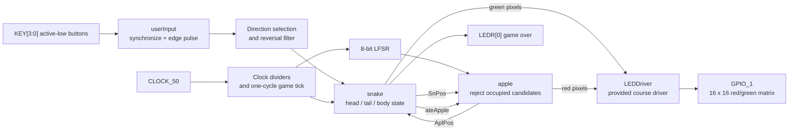
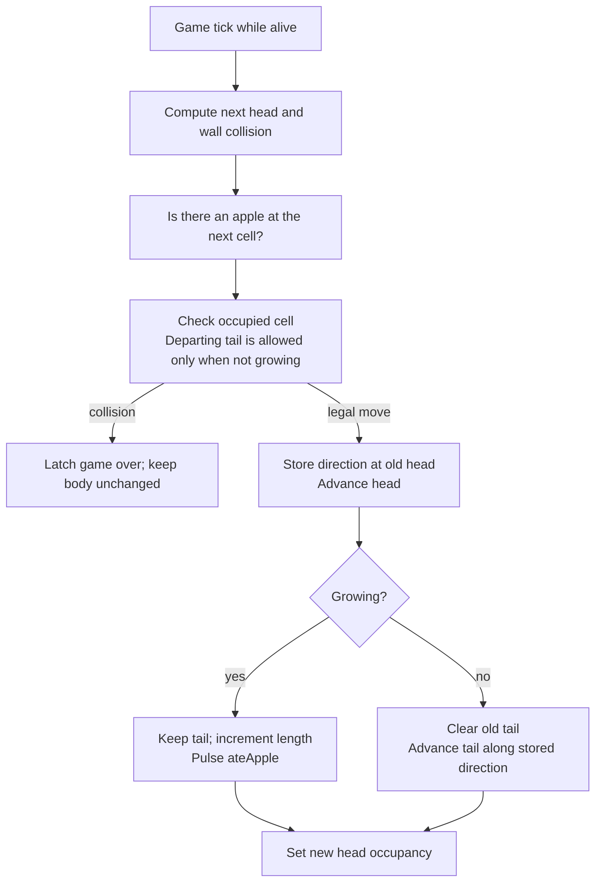

# FPGA Snake on the DE1-SoC

A Snake game written in SystemVerilog for a Cyclone V FPGA and a **16 x 16 red/green LED matrix**. The design implements movement, growth, wall/self collision, and apple placement directly in logic, without a soft CPU or operating system.

**SystemVerilog | RTL design | FPGA integration | ModelSim | Quartus**

[Original course demo (Google Drive)](https://drive.google.com/file/d/1CN-mWC4AAOlfzIJFyAhdpNwsDBxydqpY/view?usp=sharing) · [Architecture](#architecture) · [Run the tests](#run-the-tests) · [Hardware setup](#hardware-setup) · [Known limitations](#known-limitations)

The original course demo is hosted externally; its availability depends on the file's sharing settings. The original project was built for **EE 271: Digital Circuits and Systems**, University of Washington, by **Ziqian (Kevin) Xu** in 2026.

## What the project demonstrates

- **Stateful game logic:** a 256-bit occupancy map and per-cell direction memory let the tail follow the head without shifting a full coordinate list on every move.
- **Pseudo-random placement:** an 8-bit XNOR-feedback LFSR supplies candidate coordinates; the apple controller rejects occupied cells.
- **Input processing:** two-flop synchronization followed by rising-edge detection produces a one-clock pulse for a held key. This is **not a mechanical-bounce filter**.
- **Control and integration:** the top level chooses movement direction, rejects a direct opposite-direction input, generates game ticks, and connects the supplied display driver.
- **Simulation:** a self-checking regression suite exercises movement, growth, tail-cell reuse, collision/reset behavior, apple placement, input pulses, the LFSR period, and selected top-level controls.

## Architecture



Reset/clock connections omitted above are described in [known limitations](#known-limitations).

| Module | Responsibility |
|---|---|
| [`DE1_SoC`](src/DE1_SoC.sv) | Board interface, clock selection, tick edge detector, direction selection, module wiring |
| [`snake`](src/snake.sv) | Head/tail updates, occupancy, direction memory, growth, wall/self collision |
| [`apple`](src/apple.sv) | Update-edge detection and free-cell search using LFSR candidates |
| [`LFSR`](src/LFSR.sv) | Eight-bit XNOR-feedback generator, taps 8/6/5/4 |
| [`userInput`](src/userInput.sv) | Input synchronization and rising-edge pulse generation |
| [`clock_divider`](src/clock_divider.sv) | Counter bits used as divided clocks |
| [`LEDDriver`](src/LEDDriver.sv) | Supplied row-scan driver mapping red/green pixel arrays to GPIO |

### How the body moves

For each occupied cell, `dir[y][x]` records where the next body segment lies. When the head leaves a cell, its movement direction is written there; the tail reads that stored direction to find its next cell.



Setting the new head **after** clearing the old tail matters when both refer to the same cell. The focused regression reproduces the original overwrite error and protects this legal move.

## Controls

| Board element | Function |
|---|---|
| `KEY[0]` | Right |
| `KEY[1]` | Left |
| `KEY[2]` | Down |
| `KEY[3]` | Up |
| `SW[9]` | Reset input; see board-reset caveat below |
| `LEDR[0]` | Game over |

The snake is green and the apple is red. Eating grows the snake by one cell; wall or non-tail body collisions end the game. Simultaneous input priority is right, left, up, down.

With the current divider parameters, the nominal hardware game tick is about **2.98 Hz**, or one move every **336 ms**. This is calculated from the 50 MHz input and divider taps, not a new hardware measurement.

## Run the tests

The focused suite was run on **October 29, 2026** using **ModelSim ALTERA STARTER EDITION 10.5b**, installed with the Intel FPGA 17.0 tool distribution. It compiled and completed with **zero errors and zero warnings**. The departing-tail regression reproduced the original occupancy overwrite and passes with the corrected assignment order.

From the repository root, with `vsim` on your path:

```powershell
vsim -c -do src/run_regressions.do
```

The runner compiles the design and [`src/tests/regression_testbench.sv`](src/tests/regression_testbench.sv), runs for a bounded 10 microseconds, checks a completion flag, and returns a nonzero exit status on a failed check or incomplete run. Run both simulator workflows from the repository root; generated simulator files stay outside `src/`.

| Check group | Examples covered |
|---|---|
| Snake core | Reset, no-tick stability, movement, growth, one-cycle apple pulse, departing-tail reuse, self collision, four walls, game-over freeze |
| Apple controller | Known reset position, occupied-cell rejection, free-cell selection, held-update edge behavior |
| Input processing | One pulse for a held input and another for a later rising edge |
| LFSR | Known reset state and a 255-state cycle without repeats |
| Simulation top level | Reset, direct reversal rejection, perpendicular turn, simultaneous-key priority, unused seven-segment outputs |

These are directed checks, not exhaustive verification or a physical hardware validation.

### Original waveform testbenches

The original course benches and waveform setups remain available. In the **ModelSim Transcript**, run:

```tcl
do src/runlab.do
do src/runlab.do apple
```

The default selects `DE1_SoC_testbench`; an argument selects the corresponding module bench. `src/runlab.do` opens GUI waveform/structure/signal windows and runs until the bench stops. These older benches are primarily waveform stimuli; use the focused runner above for automatic pass/fail checks.

`src/Launch_ModelSim.bat` is an optional Windows launcher that expects `vsim.exe` on `PATH` and starts ModelSim with the repository root as its working directory.

## Hardware setup

1. Use a Terasic **DE1-SoC**, device **5CSEMA5F31C6**, and a compatible **16 x 16 two-color red/green** LED matrix connected to `GPIO_1`.
2. Open [`DE1_SoC.qpf`](DE1_SoC.qpf) in Quartus with Cyclone V support. The project file records Quartus Prime Lite **17.0**; that is a Quartus version, not a ModelSim version.
3. Inspect the pin assignments and matrix wiring for your exact hardware. The QSF retains board-template pin assignments; its source list points to the seven design files under `src/`.
4. Compile, inspect diagnostics/timing constraints, and program the board. Recheck reset and display behavior on the board before relying on a new bitstream.

On the hardware path, `ALTERA_RESERVED_QIS` selects `div_clk[9]` as the approximately 48.8 kHz base clock. A second divider uses bit 13 and an edge detector for the game tick. In simulation, the top level uses the testbench clock directly; the benches shorten the second divider.

No fresh Quartus synthesis, fitting, static timing analysis, FPGA resource measurement, or board test was performed for this maintenance revision. The supplied [`DE1_SoC_golden_top.sdc`](DE1_SoC_golden_top.sdc) is a board template and is not evidence of timing closure.

## Known limitations

- **Board reset needs revalidation.** The hardware base clock comes from a divider that is itself held reset by `SW[9]`, while downstream blocks use synchronous reset. This can prevent downstream reset sampling while reset is held. The supplied LED driver's reset/count priority also needs board-level review. Focused simulation uses the direct-clock path and does not prove hardware reset correctness.
- **No mechanical debounce interval.** Synchronization and edge detection do not guarantee that a bouncing switch produces only one event.
- **Rapid turns between ticks.** The reversal filter compares against the most recently accepted direction, rather than latching one turn per completed movement. Multiple turns within one game-tick interval need further testing/refinement.
- **Finite placement sequence.** The XNOR LFSR has 255 states and excludes `8'hff`, so cell `(15,15)` is the reset apple location but is not proposed again by the generator. There is no explicit full-board win/termination path.
- **Timing is uncharacterized in this revision.** The original divided-clock design is preserved; a future single-clock/clock-enable implementation could simplify reset and timing analysis.

## Repository guide

```text
DE1_SoC.qpf / .qsf             Quartus project and board assignments
DE1_SoC_golden_top.sdc         original board-template constraints
src/
  DE1_SoC.sv                  top-level integration and original game bench
  snake.sv / apple.sv         game state and apple placement
  LFSR.sv / userInput.sv      candidate generator and button processing
  clock_divider.sv            clock-divider counters
  LEDDriver.sv                supplied display driver and its original benches
  run_regressions.do          automatic pass/fail ModelSim runner
  runlab.do / *_wave.do       original GUI waveform workflow
  wave.do                    additional saved waveform setup
  Launch_ModelSim.bat         optional Windows launcher
  tests/                     focused self-checking regression source
```

## Authorship and attribution

Kevin Xu wrote and tested the original course game logic. **`LEDDriver.sv` is provided course code**, and the board project/constraint templates retain their existing notices. The repository retains its existing [MIT license](LICENSE); third-party attribution and original notices are not replaced by that file.

The October 2026 maintenance work includes AI-assisted code review, documentation, a focused regression suite, and a small occupancy-order fix validated in ModelSim. This does not imply that the supplied display driver was written by Kevin or that all hardware behavior has been verified.
